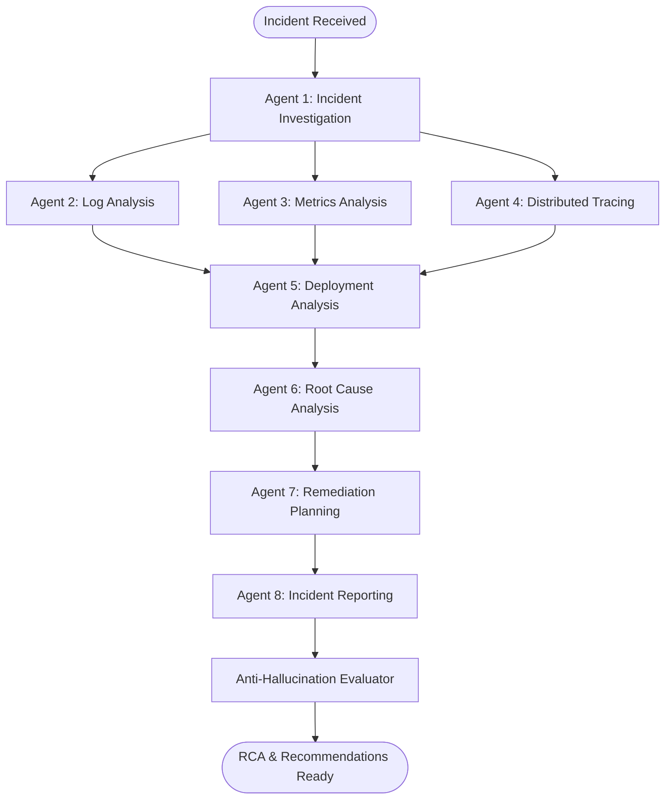

# 🤖 Multi-Agent LangGraph AI Investigation Architecture

## 1. Overview

The AI Engine is powered by **LangGraph**, orchestrating 8 specialized autonomous agents into a deterministic, cyclical-capable StateGraph. Each agent has a focused role, explicit input dependencies, and strict schema validation through Pydantic v2.

---

## 2. Specialized Agents Directory

### Agent 1: Incident Investigation Agent (`IncidentInvestigationAgent`)
- **Responsibility:** Ingests the raw incident trigger, parses affected microservices, isolates the blast radius, and defines the investigation scope.
- **Evidence Gathered:** Service dependency trees, operational SLA thresholds, and active alert clusters.

### Agent 2: Log Analysis Agent (`LogAnalysisAgent`)
- **Responsibility:** Analyzes log streams retrieved via Grafana Loki adapter, clusters error messages, identifies recurring exceptions (e.g. `NullPointerException`, `HikariPool-1 timeout`), and correlates logs with `trace_id` headers.
- **Evidence Gathered:** Error frequency, unique stack traces, and first failure occurrences.

### Agent 3: Metrics Analysis Agent (`MetricsAnalysisAgent`)
- **Responsibility:** Compares real-time Prometheus metrics against 7-day historical baselines. Detects deviations in CPU utilization, memory working set bytes, disk I/O, and P99 latency.
- **Evidence Gathered:** Percent change vs baseline, anomaly thresholds, and saturation duration.

### Agent 4: Distributed Tracing Agent (`DistributedTracingAgent`)
- **Responsibility:** Analyzes Jaeger distributed spans across microservices (`order-service -> payment-service -> notification-service`). Identifies slow inter-service HTTP hops and database query stalls.
- **Evidence Gathered:** Span durations, error flags, bottleneck span IDs.

### Agent 5: Deployment Analysis Agent (`DeploymentAnalysisAgent`)
- **Responsibility:** Cross-references incident timeline against recent CI/CD deployments and Git commits. Identifies suspect configuration changes, image digest updates, or canary release regressions.
- **Evidence Gathered:** Commit SHA, author, pull request title, deployment timestamp relative to incident onset.

### Agent 6: Root Cause Analysis Agent (`RootCauseAnalysisAgent`)
- **Responsibility:** Synthesizes findings from Agents 1 through 5, performs pgvector RAG similarity search against historical post-mortems and runbooks, ranks root cause hypotheses, and computes calibrated confidence scores (0.0 to 1.0).
- **Evidence Gathered:** Corroborated facts vs hypotheses, ranked root cause candidates.

### Agent 7: Remediation Planning Agent (`RemediationPlanningAgent`)
- **Responsibility:** Generates recovery strategies, calculates blast radius, classifies operational risk (`LOW`, `MEDIUM`, `HIGH`, `CRITICAL`), determines whether human authorization is required, and formulates rollback parameters.
- **Evidence Gathered:** Target rollback revision, dry-run safety checks, approval requirement flag.

### Agent 8: Incident Reporting Agent (`IncidentReportingAgent`)
- **Responsibility:** Compiles an executive summary, technical post-mortem RCA report, preventive action items, and lessons learned.
- **Evidence Gathered:** Timeline of events, MTTR analysis, preventive recommendations.

---

## 3. Groundedness & Anti-Hallucination Evaluator

To guarantee that the AI assistant never fabricates infrastructure events or imaginary log lines, the output of the DAG is passed through an automated verification layer (`evaluator.py`):
1. **Log Grounding:** Verifies that all cited exception names exist in the actual Loki log payload.
2. **Metric Grounding:** Verifies that metric values (e.g., 94.2% CPU or 20 active connections) match Prometheus time series.
3. **Trace Grounding:** Verifies that span IDs exist in the Jaeger trace envelope.
4. **Git Grounding:** Validates commit shas against CI/CD deployment history.

If any assertion fails, the evaluator downgrades the confidence score and tags the hypothesis with `UNVERIFIED_EVIDENCE`.
