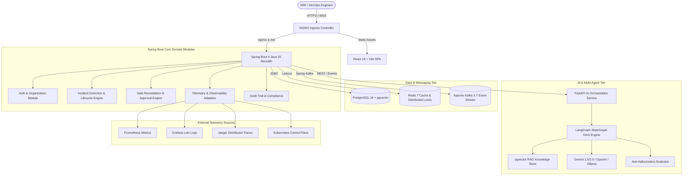
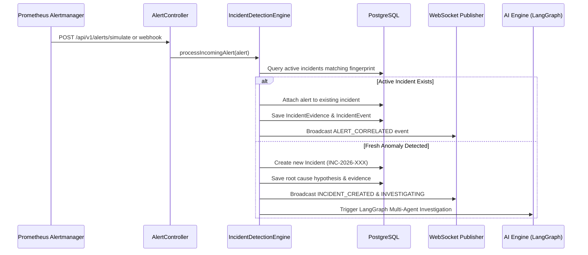

# 🏛 System Architecture Specification

## 1. Architectural Philosophy

The AI DevOps Incident Management platform is engineered as a high-throughput, low-latency Site Reliability Engineering SaaS solution. It adopts a hybrid paradigm:
- **Modular Monolith for Business Operations (Java 25 & Spring Boot 4):** Ensures strict consistency, ACID transaction guarantees, multi-tenant data isolation, security auditing, and rock-solid integrations with cloud infrastructure.
- **Python Dedicated AI Orchestrator (Python 3.12 & LangGraph):** Handles non-deterministic AI agent workflows, dynamic acyclic graph (DAG) routing, vector embeddings, and real-time LLM integration.

---

## 2. Multi-Tenant Organization Data Isolation

Data isolation is guaranteed across all domain entities using organization-level scoping:
1. Every domain table (`users`, `organizations`, `services`, `incidents`, `alerts`, `remediation_actions`, `audit_logs`) includes an `organization_id` foreign key.
2. In Spring Security 7, the `JwtAuthenticationFilter` resolves the authenticated `UserPrincipal`, extracting the `organizationId`.
3. Organization boundaries are validated at the service layer; IDs provided by frontend clients are never trusted without active membership verification.

---

## 3. High-Throughput Event-Driven Alert Ingestion

Incoming monitoring alerts (from Prometheus Alertmanager, Grafana Webhooks, Datadog, or AWS CloudWatch) are processed through an asynchronous correlation pipeline:

---

## 4. Telemetry Adapters

The platform decouples monitoring ingestion through standardized adapter services:
- **`PrometheusAdapter` (`MonitoringService.java`):** Queries time-series data, metric vectors, CPU/RAM utilization, P99 request latencies, and active database connection pool stats.
- **`LokiAdapter` (`LogService.java`):** Executes LogQL queries, performs error grouping, extracts trace IDs from log lines, and identifies recurring stack traces.
- **`JaegerAdapter` (`TraceService.java`):** Fetches distributed trace spans, calculates inter-service network transit latency, and identifies bottleneck dependencies.
- **`KubernetesAdapter` (`KubernetesService.java`):** Connects to Kubernetes clusters to inspect pod readiness, detect `CrashLoopBackOff`, extract container termination exit codes (e.g. 137 for OOMKilled), and execute rollbacks.

---

## 5. Security & Safe Remediation Architecture

Remediation actions are categorized by operational risk level:
- **LOW:** Cache purge, connection pool reload, log level modification (Auto-executable if enabled).
- **MEDIUM:** Horizontal Pod Autoscaler target adjustment, worker thread pool scale.
- **HIGH:** Pod restart, traffic rerouting, circuit breaker trip (Requires human approval).
- **CRITICAL:** Kubernetes deployment rollback, database schema migration rollback (Requires senior SRE authorization).

Safe Execution Pipeline:
1. AI generates recommended remediation plan with classified risk.
2. If risk >= HIGH, an approval entity (`RemediationApproval`) is created in status `PENDING`.
3. Authorized SRE reviews impact analysis, before-state telemetry, and approves with audit notes.
4. Engine executes a dry-run validation to ensure rollback targets exist.
5. Live recovery action executed against Kubernetes cluster.
6. Post-execution health probes verify recovery; incident automatically transitions to `RESOLVED`.
