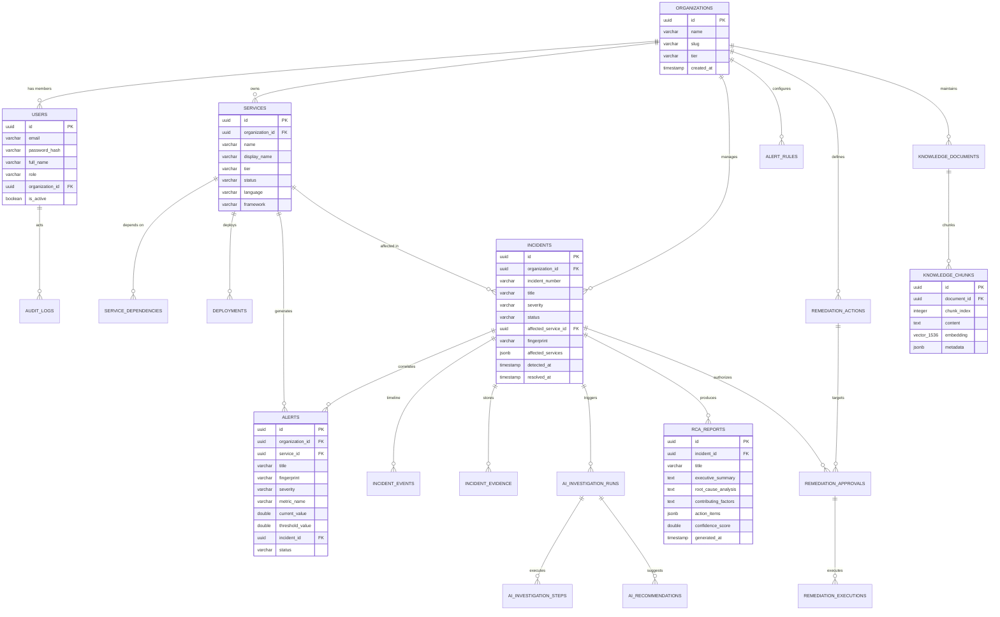

# 🗄 Database Entity-Relationship (ER) Model

The database is built on **PostgreSQL 16** with the **pgvector** extension for semantic vector embeddings. All schemas and baseline seeds are versioned via Flyway migrations (`V1` to `V6`).

---

## Migration History

- `V1__init_auth_and_organizations.sql`: Multi-tenant organization tables, users, roles, permissions, and refresh tokens.
- `V2__init_infrastructure_and_monitoring.sql`: Environments, clusters, namespaces, services, dependencies, deployments, and metric events.
- `V3__init_alerts_and_incidents.sql`: Alert rules, firing alerts, incident state machine, timeline events, and evidence.
- `V4__init_ai_agents_and_rca.sql`: Multi-agent investigation runs, individual agent steps, RCA post-mortems, and recommendations.
- `V5__init_remediation_and_knowledgebase.sql`: Safe remediation actions, human approvals, execution history, pgvector knowledge docs/chunks, and audit logs.
- `V6__seed_initial_data.sql`: Seeded Acme Corp organization, admin/sre users, demo services, active incident `INC-2026-001`, and runbooks.
